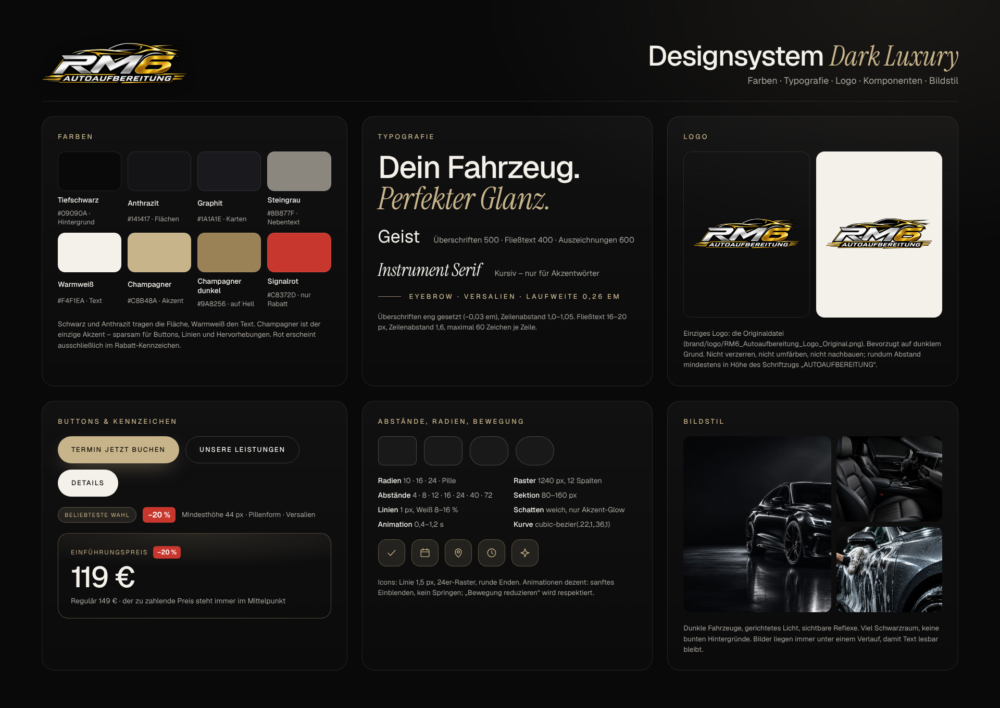

# RM6 Autoaufbereitung – Markenidentität

## Logo

Es gibt **ein** Logo: die vom Inhaber gelieferte Datei – Schriftzug **„RM6“** (Chrom/Gold) mit Fahrzeugsilhouette und dem Band **„AUTOAUFBEREITUNG“**, auf transparentem Hintergrund. Es wird nicht nachgebaut, umgefärbt oder verändert.

| Datei | Verwendung |
| --- | --- |
| `logo/RM6_Autoaufbereitung_Logo_Original.png` | **Originaldatei** (2172 × 724 px, transparent) – unverändert, Quelle für alles andere |
| `logo/RM6_Autoaufbereitung_Logo_transparent.png` | dieselbe Grafik ohne die leeren transparenten Ränder (2116 × 644 px) – für Druck und Layouts |
| `../src/assets/rm6-logo.png` | Website-Version (1400 px breit); die Website liefert daraus automatisch passende Größen aus |
| `social/profilbild-1080.png` | Profilbild für Instagram, Facebook und Google (Logo innerhalb des runden Zuschnitts) |
| `logo/vorschau-dunkel.png` / `vorschau-hell.png` | Kontrollansicht auf dunklem und hellem Hintergrund |

**Einsatz:** bevorzugt auf dunklem Grund (Schwarz/Anthrazit) – dort wirken Chrom und Gold am stärksten. Auf hellem Grund bleibt es dank der schwarzen Konturen lesbar. Seitenverhältnis immer beibehalten; rundum Abstand mindestens in Höhe des Schriftzugs „AUTOAUFBEREITUNG“.

**Grenzen der Datei:** Das Logo ist eine Pixelgrafik mit Farbverläufen. Für Druck bis etwa 35 cm Breite reicht die Auflösung (≥ 150 dpi); für große Formate, Folienplot oder Stickerei braucht es eine Vektorfassung, die ein Grafiker vom Original anlegen müsste. Favicon und App-Icons zeigen das komplette Logo auf dunkler Fläche – in sehr kleinen Größen (16–32 px) ist der Schriftzug dort naturgemäß kaum lesbar.

Neu erzeugen (Website-Version, Icons, Vorschauen, Open-Graph-Bild): `node scripts/build-brand-assets.mjs logo og`.

## Farben

| Name | Hex | Einsatz |
| --- | --- | --- |
| Tiefschwarz | `#09090A` | Hintergrund |
| Anthrazit | `#141417` / `#1A1A1E` | Flächen, Karten |
| Warmweiß | `#F4F1EA` | Text |
| Champagner | `#C8B48A` | Akzent, Buttons, Linien |
| Champagner dunkel | `#9A8256` | Akzent auf hellem Hintergrund |
| Steingrau | `#8B877F` | Nebentext |
| Signalrot | `#C8372D` | ausschließlich Rabatt-Kennzeichen (z. B. „−20 %“) |

## Designsystem

`designsystem.png` fasst Farben, Typografie, Logo, Buttons, Kennzeichen, Preisanzeige, Radien/Abstände, Icons, Bewegung und Bildstil zusammen. Die technischen Werte (CSS-Variablen) stehen in `src/app/globals.css`.

## Social-Media-Vorlagen

| Datei | Format | Inhalt |
| --- | --- | --- |
| `social/instagram-einfuehrungspreis.jpg` | 1080×1350 | Einführungspreis −20 % |
| `social/instagram-leistung.jpg` | 1080×1350 | Leistung im Fokus (Innenraum Premium) |
| `social/instagram-vorher-nachher.jpg` | 1080×1350 | Vorher/Nachher – **Vorlage mit Beispielbild**, vor dem Posten eigene Fotos einsetzen |
| `social/werbebanner.jpg` | 1200×628 | Werbebanner (Facebook/Google-Anzeigen, Link-Vorschau) |
| `social/hintergrund/*.jpg` | – | dieselben Layouts ohne Texte (Grundlage der bearbeitbaren Canva-Seiten) |

Quelle: `scripts/social/vorlagen.html`, neu erzeugen mit `node scripts/build-social-assets.mjs` (rendert mit den Schriften und Bildern der Website). Preise in den Vorlagen entsprechen den Startwerten – bei Preisänderungen anpassen.

## Schriften

- **Geist** (Variable, SIL OFL) – Überschriften, Fließtext
- **Instrument Serif Italic** (SIL OFL) – Akzentwörter („*Perfekter Glanz.*“)

## Canva

Im verbundenen Canva-Konto liegen aus einer früheren Phase die Designs „Social-Media-Grafik“ und „Moodboard“ sowie Uploads. Sie zeigen **noch das frühere Logo** und wurden beim Rebranding nicht verändert (keine Änderungen an externen Plattformen ohne Freigabe). Die Exporte dieser Designs wurden aus dem Repository entfernt; aktuelle Grafiken mit dem RM6-Logo liegen unter `social/`. Fotoquellen der Website: `canva/source/`.

Hinweis: Die Fotos sind KI-generiert (Canva) und zeigen keine echten Kundenfahrzeuge. Sie eignen sich als Bildwelt; Vorher/Nachher-Bilder sollten durch echte Arbeiten ersetzt werden.
