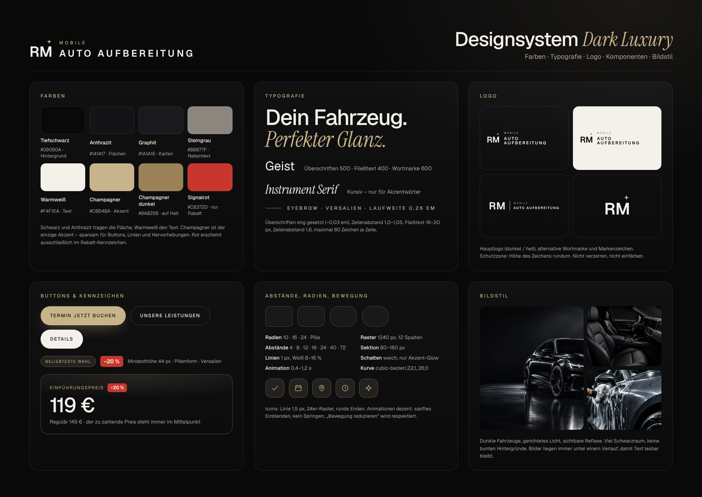

# RM Mobile Autoaufbereitung – Markenidentität

## Logo

Das Zeichen ist das Monogramm **„RM“** (Geist SemiBold) mit einem goldenen **Glanzpunkt** über dem „M“ – wie die Lichtkante auf poliertem Lack. Daneben steht der Name zweizeilig: klein *MOBILE*, groß **AUTOAFBEREITUNG**. Zusammen gelesen: **RM Mobile Autoaufbereitung**. Die Pfaddaten des Zeichens liegen in `src/components/site/Logo.tsx` (eine Quelle für Website und Logo-Dateien).

| Datei | Verwendung |
| --- | --- |
| `logo/rm-logo-fuer-dunklen-hintergrund.svg` / `.png` | Logo auf Schwarz/Anthrazit (Website, Social Media) |
| `logo/rm-logo-fuer-hellen-hintergrund.svg` / `.png` | Logo auf Weiß/hellen Flächen (Briefpapier, Rechnungen, Aufkleber) |
| `logo/rm-wortmarke-fuer-dunklen-hintergrund.svg` / `…-hellen-…` | Reine Wortmarke „RM | MOBILE AUTOAUFBEREITUNG“ ohne Glanzpunkt (schmale Flächen, Fußzeilen, Stempel) |
| `logo/rm-logo-gestapelt-dunkel.svg` / `-hell.svg` | Gestapeltes Logo: Zeichen über der Wortmarke (quadratische Flächen, Aufkleber) |
| `logo/rm-emblem-hell.svg` / `-dunkel.svg` | Nur das Zeichen (Favicon, Stempel) |
| `social/profilbild-1080.png` | Profilbild für Instagram, Facebook und Google (kreisrund zuschneidbar) |
| `logo/vorschau-*.png` | Kontrollansicht auf dunklem und hellem Hintergrund |

Alle SVGs enthalten Pfade statt Schrift und sind damit überall identisch darstellbar. Neu erzeugen: `node scripts/build-brand-assets.mjs`.

## Farben

| Name | Hex | Einsatz |
| --- | --- | --- |
| Tiefschwarz | `#09090A` | Hintergrund |
| Anthrazit | `#141417` / `#1A1A1E` | Flächen, Karten |
| Warmweiß | `#F4F1EA` | Text, Logo auf dunkel |
| Champagner | `#C8B48A` | Akzent, Buttons, Glanzpunkt |
| Champagner dunkel | `#9A8256` | Akzent auf hellem Hintergrund |
| Steingrau | `#8B877F` | Nebentext |
| Signalrot | `#C8372D` | ausschließlich Rabatt-Kennzeichen (z. B. „−20 %“) |

## Designsystem

`designsystem.png` fasst Farben, Typografie, Logo-Varianten, Buttons, Kennzeichen, Preisanzeige, Radien/Abstände, Icons, Bewegung und Bildstil zusammen. Die technischen Werte (CSS-Variablen) stehen in `src/app/globals.css`.

## Social-Media-Vorlagen

| Datei | Format | Inhalt |
| --- | --- | --- |
| `social/instagram-einfuehrungspreis.jpg` | 1080×1350 | Einführungspreis −20 % |
| `social/instagram-leistung.jpg` | 1080×1350 | Leistung im Fokus (Innenraum Premium) |
| `social/instagram-vorher-nachher.jpg` | 1080×1350 | Vorher/Nachher – **Vorlage mit Beispielbild**, vor dem Posten eigene Fotos einsetzen |
| `social/werbebanner.jpg` | 1200×628 | Werbebanner (Facebook/Google-Anzeigen, Link-Vorschau) |
| `social/hintergrund/*.jpg` | – | dieselben Layouts ohne Texte (Grundlage der bearbeitbaren Canva-Seiten) |

Quelle: `scripts/social/vorlagen.html`, neu erzeugen mit `node scripts/build-social-assets.mjs` (rendert mit den Schriften und Bildern der Website). Preise in den Vorlagen entsprechen den Startwerten – bei Preisänderungen anpassen.

## Schriften

- **Geist** (Variable, SIL OFL) – Überschriften, Fließtext, Wortmarke
- **Instrument Serif Italic** (SIL OFL) – Akzentwörter („*Perfekter Glanz.*“)

## Canva

Erstellt im verbundenen Canva-Konto:

| Design | Inhalt |
| --- | --- |
| **RM Mobile Autoaufbereitung Social-Media-Grafik** | Seite 1: Instagram-Post (1080×1440) · 2: Instagram-Story (1080×1920) · 3: Facebook-Titelbild (1640×624) · 4: Profilbild (1080×1080) · 5: Instagram-Vorlage „Einführungspreis“ · 6: Instagram-Vorlage „Leistung“ · 7: Instagram-Vorlage „Vorher/Nachher“ · 8: Werbebanner (1200×628). Auf den Seiten 5–8 sind Überschriften, Preise und Buttons **bearbeitbare Texte** |
| **RM Mobile Autoaufbereitung Moodboard** | Bildwelt der Website; die Fotos (Hero, Innenraum, Handwäsche, Graz bei Nacht) wurden mit Canva generiert und von hier in voller Auflösung exportiert |
| Uploads | Logo-Varianten, Profilbild, Vorlagen-Hintergründe und das Designsystem-Board liegen in den Canva-Uploads |

Exporte im Repository: `canva/instagram-post.jpg`, `canva/instagram-story.jpg`, `canva/facebook-titelbild.jpg`, `canva/profilbild.jpg`, `canva/instagram-vorlage-*.jpg`, `canva/werbebanner.jpg`, Fotoquellen unter `canva/source/`.

Hinweise: Canva verwendet für neu angelegte Texte seine Standardschrift – für exakt die Website-Typografie in Canva die Schrift „Geist“ hochladen (Markenkit) oder die fertigen Grafiken aus `social/` verwenden. Die KI-Funktionen von Canva (Bild-/Design-Generierung) waren im Konto aufgebraucht; die neuen Seiten wurden deshalb aus eigenen Layouts aufgebaut.

Hinweis: Die Fotos sind KI-generiert (Canva) und zeigen keine echten Kundenfahrzeuge. Sie eignen sich als Bildwelt; Vorher/Nachher-Bilder sollten durch echte Arbeiten ersetzt werden.
